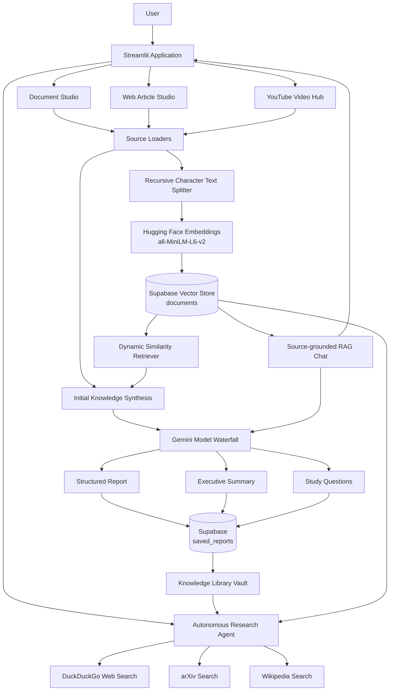
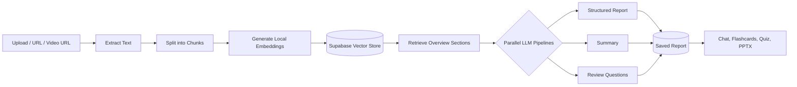
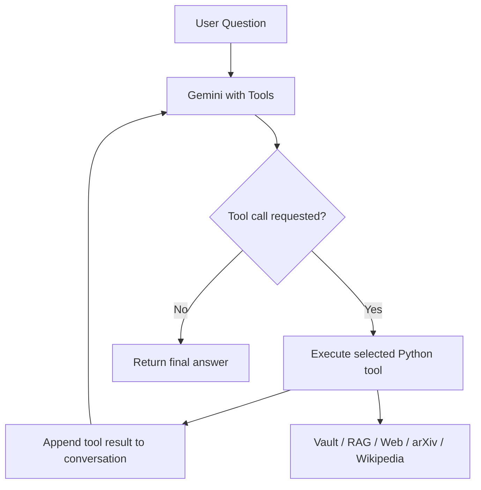

# 🧭 ResearchPilot

**An AI-powered knowledge hub that transforms documents, web articles, and YouTube lectures into structured research insights and interactive study material.**

ResearchPilot combines a Streamlit interface, LangChain pipelines, Gemini models, local Hugging Face embeddings, and a Supabase-backed vector store. Analyze a source once, explore it through retrieval-augmented chat, generate learning resources, or use the research agent to combine your saved knowledge with live web and academic search.

<p align="center">
  <strong>Document Studio</strong> · <strong>Web Article Studio</strong> · <strong>YouTube Hub</strong> · <strong>Autonomous Research Agent</strong>
</p>

---

## ✨ Features

| Workspace | What it does |
|---|---|
| **📄 Document Studio** | Upload PDF, TXT, or Markdown files—or paste text—to generate a structured knowledge report. |
| **🌐 Web Article Studio** | Extract and analyze text from online articles, blogs, documentation, and accessible web pages. |
| **🎥 YouTube Video Hub** | Fetch available English or Hindi transcripts, analyze the content, and keep the video accessible alongside its notes. |
| **🕵️ Autonomous Research Agent** | Use tool calling to search the saved knowledge vault, live web results, arXiv, and Wikipedia. |
| **📚 Knowledge Library Vault** | Save analyzed reports and document chunks in Supabase for later retrieval. |
| **💬 Chat with Source (RAG)** | Ask source-focused questions and inspect the retrieved chunks that support an answer. |
| **🧠 Structured Research Reports** | Generate an overview, central problem/theme, key takeaways, deeper analysis, practical findings, concepts, strengths, limitations, and conclusion. |
| **📝 Summaries & Study Questions** | Generate an executive summary and open-ended review questions. |
| **🃏 Flashcards** | Create concept/answer cards from retrieved sections of the source. |
| **✅ MCQ Quizzes** | Generate multiple-choice questions, submit answers, and view grading with explanations. |
| **📽️ PowerPoint Export** | Generate a PPTX presentation with slide bullets and speaker notes, then download it. |
| **🎛️ Reading Preferences** | Choose an explanation style—Academic, Beginner Friendly, Interview Preparation, or Technical—and a detail level. |
| **🔎 Source X-Ray** | Show a lightweight word-count, estimated reading-time, and keyword snapshot of the retrieved overview. |
| **🪙 Token Optimization & Deduplication** | Before ingestion, check `saved_reports.source_name` for an existing source in the Document, Web Article, and YouTube workflows; skip repeated analysis instead of rebuilding embeddings and calling the LLM again. |
| **📁 Single-File Ingestion Guard** | Document uploads set `accept_multiple_files=False`; the Document Studio also applies CSS to hide the Streamlit uploader dropzone. |
| **📡 Live AI Pulse** | Display a randomly selected AI/architecture fact in the synthesis status flow to make the wait state more informative. |
| **🌌 Midnight Mountain UI** | Apply a dark gradient, glassmorphism-style bordered cards, hover-lift interactions, and color-coded source badges. |

---

## 🧭 Application Architecture



### Source analysis lifecycle



### Agent tool-calling flow



The agent is implemented with LangChain tool definitions and a bounded tool-calling loop. It can call tools for multiple rounds before returning a final answer.

---

## 🧰 Tech Stack

| Layer | Technology | Role |
|---|---|---|
| UI | [Streamlit](https://streamlit.io/) | Multi-page interactive application and session state |
| LLM orchestration | [LangChain](https://www.langchain.com/) | Prompts, runnables, retrieval, structured output, and tools |
| Language models | Google Gemini via `langchain-google-genai` | Research synthesis, question answering, structured study content, and agent tool selection |
| Structured validation | [Pydantic](https://docs.pydantic.dev/) | Schemas for reports, flashcards, quizzes, and presentations |
| Embeddings | Hugging Face `all-MiniLM-L6-v2` | Local text embedding generation |
| Vector storage | [Supabase](https://supabase.com/) with pgvector | Persistent document chunks and similarity search |
| Document parsing | `pypdf` / LangChain document loaders | PDF and web text extraction |
| YouTube transcripts | `youtube-transcript-api` | Retrieval of available video captions |
| Research sources | DuckDuckGo Search (`ddgs`), `arxiv`, `wikipedia` | Live discovery through the research agent |
| Export | `python-pptx` | Downloadable presentations with speaker notes |
| Configuration | `python-dotenv` | Load local environment variables |

### Model fallback strategy

The shared model factory in `core/engine.py` configures a primary Gemini model (`gemini-3.8-flash`) and a fallback model (`gemini-3.5-flash-lite`). It can bind tools or a Pydantic structured-output schema before applying the fallback chain. Model availability depends on your Google AI account and current API access; change the model IDs in `core/engine.py` if needed.

---

## 🗂️ Project Structure

```text
ResearchPilot/
├── app.py                      # Streamlit navigation and global reading preferences
├── requirements.txt            # Python dependencies
├── .gitignore                  # Environment, cache, and OS files excluded from Git
├── core/
│   ├── engine.py               # Gemini fallback chain and local embeddings
│   ├── loaders.py              # PDF/text, web, and YouTube ingestion; chunking and indexing
│   ├── schemas.py              # Pydantic report, flashcard, quiz, and slide schemas
│   ├── study_tools.py          # Retrieval, analysis pipeline, RAG chat, quizzes, cards, PPTX
│   └── ui_ux.py                # Shared visual styling and UI helpers
└── views/
    ├── home.py                 # Dashboard and saved knowledge library
    ├── document_studio.py      # File upload / pasted-text workflow
    ├── article_studio.py       # URL-based article analysis
    ├── youtube_studio.py       # Transcript analysis and video player
    └── agent_workspace.py      # Multi-tool research agent and conversation UI
```

---

## ⚙️ Getting Started

### Prerequisites

- Python **3.10 or newer** recommended.
- A [Google AI Studio](https://aistudio.google.com/) API key with access to the configured Gemini models.
- A [Supabase](https://supabase.com/) project with the required vector database objects.
- Internet access for model API calls and online source loading.
- Local CPU resources for the Hugging Face embedding model. The embedding model is downloaded the first time it is initialized.

### 1. Clone the repository

```bash
git clone https://github.com/AnaghGoel/ResearchPilot.git
cd ResearchPilot
```

### 2. Create and activate a virtual environment

**macOS / Linux**
```bash
python3 -m venv .venv
source .venv/bin/activate
```

**Windows (PowerShell)**
```powershell
py -m venv .venv
.venv\Scripts\Activate.ps1
```

### 3. Install dependencies

```bash
python -m pip install --upgrade pip
pip install -r requirements.txt
```

### 4. Configure environment variables

Create a file named `.env` in the repository root:

```dotenv
GOOGLE_API_KEY=your_google_ai_studio_api_key
SUPABASE_URL=https://your-project.supabase.co
SUPABASE_SERVICE_KEY=your_supabase_service_role_key
```

Replace the example values with your own credentials. Do not commit `.env` or paste service-role keys into public issues, screenshots, notebooks, or client-side code. The repository's `.gitignore` excludes `.env` already.

### 5. Configure Supabase

ResearchPilot expects two database objects and one RPC function:

- **`documents`** — vector-store table with `id`, `content`, `metadata` (JSONB), and `embedding` (pgvector) columns.
- **`match_documents`** — RPC function used by SupabaseVectorStore for vector similarity search. It must accept the query embedding, match count, and metadata filter expected by the installed LangChain Supabase integration.
- **`saved_reports`** — table used to persist report metadata and generated analysis. It needs `report_id`, `title`, `source_type`, `source_name`, `namespace`, `result_json` (JSONB), and `created_at` columns.

The configured `all-MiniLM-L6-v2` embedding model produces **384-dimensional vectors**, so the `documents.embedding` column and the `match_documents` function's query parameter must use `vector(384)`. Enable the `vector` extension in Supabase before creating these objects.

<details>
<summary><strong>SQL bootstrap script — expand to create the required tables and RPC function</strong></summary>

Run this once in the **Supabase Dashboard → SQL Editor** for a new project. The schema below matches the application's `SupabaseVectorStore` usage and the 384-dimensional `all-MiniLM-L6-v2` embedding model.

```sql
-- Enable pgvector. Supabase projects commonly keep extensions in the extensions schema.
create schema if not exists extensions;
create extension if not exists vector with schema extensions;

-- Stores the chunk text, metadata, and 384-dimensional embedding.
-- UUID IDs are compatible with IDs generated by LangChain's SupabaseVectorStore.
create table if not exists public.documents (
    id uuid primary key default gen_random_uuid(),
    content text not null,
    metadata jsonb not null default '{}'::jsonb,
    embedding extensions.vector(384) not null
);

-- Optional but recommended as the document collection grows.
create index if not exists documents_embedding_hnsw_idx
    on public.documents
    using hnsw (embedding extensions.vector_cosine_ops);

-- Similarity-search RPC used by LangChain's SupabaseVectorStore.
-- The JSONB containment filter supports report-level filtering via metadata.report_id.
create or replace function public.match_documents (
    query_embedding extensions.vector(384),
    match_count int default null,
    filter jsonb default '{}'::jsonb
)
returns table (
    id uuid,
    content text,
    metadata jsonb,
    similarity float
)
language sql
stable
as $$
    select
        d.id,
        d.content,
        d.metadata,
        1 - (d.embedding <=> query_embedding) as similarity
    from public.documents as d
    where d.metadata @> filter
    order by d.embedding <=> query_embedding
    limit match_count;
$$;

-- Stores report metadata and the initial generated analysis.
create table if not exists public.saved_reports (
    report_id text primary key,
    title text not null,
    source_type text not null,
    source_name text not null,
    namespace text not null,
    result_json jsonb not null,
    created_at timestamptz not null default now()
);

-- The app uses the Supabase service-role key only on the server side.
-- Enable RLS as a safety default; service_role bypasses RLS in Supabase.
alter table public.documents enable row level security;
alter table public.saved_reports enable row level security;

grant select, insert, update, delete on public.documents to service_role;
grant select, insert, update, delete on public.saved_reports to service_role;
grant execute on function public.match_documents(extensions.vector, integer, jsonb) to service_role;
```

**Important:** This is a bootstrap schema for a new database, not a migration. If you already have tables or a `match_documents` function, inspect them before running the script. `CREATE TABLE IF NOT EXISTS` will not repair an existing table with incompatible column types. In particular, `documents.id` and the function's returned `id` must use compatible types, and the embedding column, query argument, and embedding model must all agree on **384 dimensions**. Do not expose `SUPABASE_SERVICE_KEY` in browser-side code.

</details>

### 6. Run ResearchPilot

From the repository root, with the virtual environment active:

```bash
streamlit run app.py
```

Streamlit will print a local URL (usually `http://localhost:8501`). Open it in your browser.

---

## 🧪 Using ResearchPilot

### 1. Analyze a source

1. Open **Document Studio**, **Web Article Studio**, or **YouTube Video Hub**.
2. Upload a PDF/TXT/Markdown file or paste text, provide an article URL, or provide a YouTube URL.
3. Choose your preferred explanation style and detail level in the sidebar.
4. Start analysis. ResearchPilot extracts and chunks the content, embeds it, stores the chunks, and retrieves relevant sections for synthesis.
5. Review the structured report, summary, and study questions.

### 2. Explore and study the material

- Use **Chat with Source** to ask questions grounded in the selected source.
- Inspect retrieved source chunks to see the text provided as context to the answer.
- Generate flashcards and an MCQ quiz; submit quiz answers to see the score and explanations.
- Generate and download a PPTX presentation with speaker notes.

### 3. Use the Autonomous Research Agent

Ask the agent questions that need one or more of the following tools:

| Tool | Purpose |
|---|---|
| `list_active_vault_documents` | List sources saved in the knowledge vault |
| `search_loaded_knowledge_base` | Retrieve semantically relevant chunks from loaded PDFs, web articles, and YouTube transcripts |
| `search_web` | Search live DuckDuckGo web results |
| `search_arxiv` | Find relevant academic papers and abstracts on arXiv |
| `search_wikipedia` | Look up established encyclopedic concepts and historical topics |

The agent can combine sources, but always verify important facts against the original paper or source.

---

## 🔬 Retrieval and generation details

| Component | Current behavior |
|---|---|
| Chunking | Recursive character splitting, target chunk size **1,500 characters**, overlap **200 characters** |
| Embeddings | Local `all-MiniLM-L6-v2` via LangChain Hugging Face embeddings |
| Vector storage | Supabase table `documents`; source chunks are tagged with a `report_id` |
| Retrieval | Similarity search, with the result count adjusted by query breadth and use case |
| Source isolation | The knowledge workspace adds a `report_id` metadata filter to retrieval |
| Initial synthesis | Structured report, summary, and questions run as parallel LangChain branches |
| Structured outputs | Pydantic schemas define expected fields for report, flashcards, quizzes, and slides |
| Agent execution | Tool calls are executed in a bounded loop (up to five LLM rounds in the current implementation) |
| Token optimization | Source-name duplicate checks run before chunking/indexing and LLM synthesis in the Document, Web Article, and YouTube workflows. These checks key on `source_name`, not a content hash. |
| Upload guard | The Document Studio accepts one file per run (`accept_multiple_files=False`) and applies a CSS rule to hide the uploader dropzone. |
| Synthesis status UX | A randomly selected AI/architecture fact is displayed in the synthesis status flow. A separate rotating pulse helper is also defined in `core/ui_ux.py`. |
| Pydantic compatibility | Serialization checks for dictionaries, then `.model_dump()` (Pydantic v2), then `.dict()` (Pydantic v1), before saving structured reports. |
| Presentation export | PPTX slides include bullet points and speaker notes |

---

## 🔐 Configuration, privacy, and limitations

- **API keys:** Keep Google and Supabase secrets in environment variables or your deployment platform's secret manager. Treat the Supabase service-role key as highly privileged.
- **Cloud processing:** Source text and embeddings are sent to the configured Gemini and Supabase services. Review those providers' terms and privacy settings before uploading sensitive or confidential material.
- **Web ingestion:** Some sites may block automated extraction or require JavaScript/cookies. Only accessible page text can be analyzed.
- **YouTube captions:** Transcript extraction depends on captions being available and accessible in English or Hindi. Not every video provides usable transcripts.
- **Context and retrieval:** Long sources are chunked and the report synthesis uses retrieved overview sections; not every original passage is necessarily included in the initial report. Use source chat to investigate specific sections.
- **Generated content:** Reports, quizzes, flashcards, and agent answers may contain errors. Review results before relying on them for academic, professional, or consequential decisions.
- **Persistence:** Base reports and source chunks are stored in Supabase. Interactive chat history and generated study artifacts are managed in Streamlit session state and may not persist across a new session.
- **Duplicate detection:** The ingestion guard compares the incoming `source_name` with values in `saved_reports`. It prevents re-analysis of matching filenames/URLs, but it is not content-based deduplication; different filenames containing identical content may still be processed separately. In Document Studio, pasted text currently uses the generic source label `Pasted Text`, so a later unrelated pasted-text submission may also be treated as a duplicate.
- **Uploader CSS:** The current Document Studio CSS selector hides `[data-testid="stFileUploadDropzone"]` unconditionally, rather than only after a file is selected. Depending on Streamlit's rendered UI, this can hide the upload control itself; verify the uploader in your target environment or make the selector conditional if needed.
- **Database setup:** The repository's README now includes a Supabase SQL bootstrap block. If you prefer versioned migrations, keep the same schema in a separate SQL migration file and update it alongside code changes.
- **Runtime costs and quotas:** Gemini API limits and availability depend on your account. Local embeddings also use CPU and memory on the host running Streamlit.

---

## 🛠️ Troubleshooting

| Problem | What to check |
|---|---|
| Gemini authentication or model error | Confirm `GOOGLE_API_KEY` is correct and the model IDs in `core/engine.py` are available to your account. |
| Supabase initialization/query error | Verify `SUPABASE_URL`, `SUPABASE_SERVICE_KEY`, table columns, `match_documents` function, and pgvector dimension. |
| Article extraction fails | Try another accessible URL; some pages block scraping. |
| YouTube transcript fails | Verify the video URL and that English or Hindi captions can be fetched. |
| No answers from source chat | Confirm the source was indexed and its chunks contain relevant text; check that `report_id` metadata is attached. |
| Dependency/import errors | Activate the project's virtual environment and rerun `pip install -r requirements.txt`. |

---

## 🗺️ Possible future improvements

- Add a checked-in database migration file and automated tests.
- Persist generated flashcards, quiz attempts, PPTX metadata, and chat history.
- Add report export to Markdown/PDF and citation-oriented answers with page/URL references.
- Add richer ingestion status, retries, and per-source error reporting.
- Add authentication and per-user access controls before exposing a shared deployment.
- Add evaluation datasets to measure retrieval quality, grounding, and study-question quality.

## 👤 Author

**Anagh Goel** — [GitHub](https://github.com/AnaghGoel)

## License

This project is licensed under the [MIT License](LICENSE).

Copyright (c) 2026 Anagh Goel

You are free to use, modify, and distribute this software in accordance with the MIT License. See the `LICENSE` file for the full terms.

---

<p align="center">
  Built to make dense research material easier to explore, understand, and learn from.
</p>


